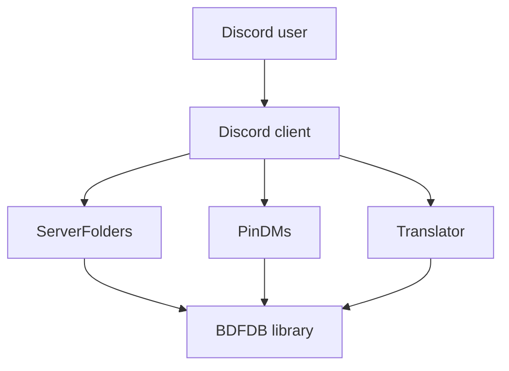

# mwittrien/BetterDiscordAddons

> Collection of BetterDiscord plugins and themes, to customize the Discord client.

## The problem
The Discord client lacks some options (server folders, pinned messages, translation).

## What it actually does
The repo gathers JavaScript plugins, including ServerFolders, PinDMs, PersonalPins, Translator, ImageUtilities and SpotifyControls, all built on the shared BDFDB library (0BDFDB.plugin.js), which modifies Discord's interface. The README contains only two headings and a copyright notice.

## How it is wired

## Trying it
No command documented in the README.

## Cost and gotchas
Free (GPL-2.0). BetterDiscord must be installed separately. Modifying the Discord client may violate Discord's terms: check before use.

## What it is not
It is not an official Discord tool. The README describes neither installation nor any plugin.

## Alternatives
No alternative named in the README.

## For you
Ignore: Discord interface customization, unrelated to data, AI or MLOps work.
