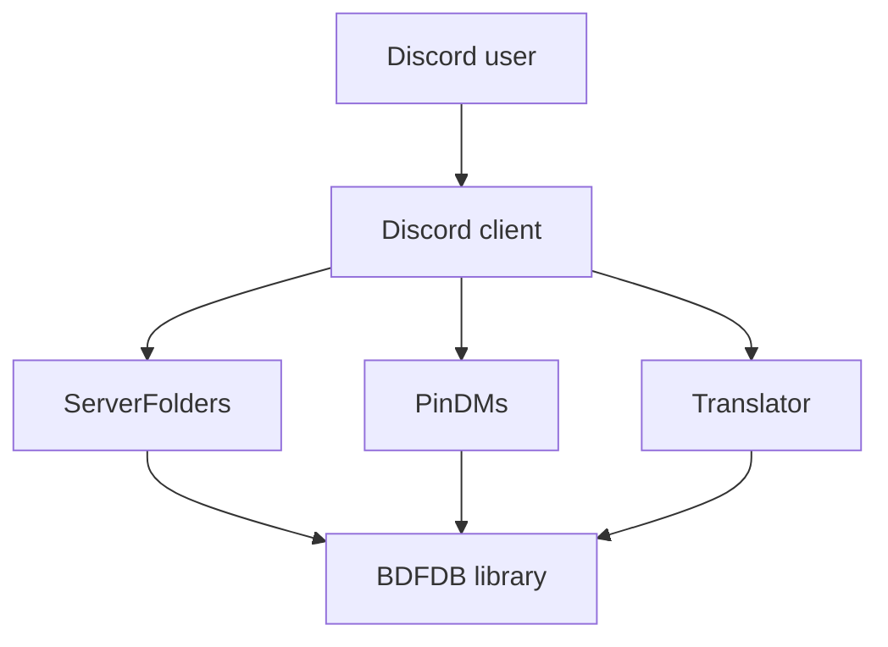

# mwittrien/BetterDiscordAddons

> Collection de plugins et de thèmes BetterDiscord, pour personnaliser le client Discord.

## Le problème
Le client Discord n'offre pas certaines options (dossiers de serveurs, messages épinglés, traduction).

## Ce que ça fait vraiment
Le dépôt réunit des plugins JavaScript, dont ServerFolders, PinDMs, PersonalPins, Translator, ImageUtilities et SpotifyControls, tous appuyés sur la bibliothèque partagée BDFDB (0BDFDB.plugin.js), qui modifie l'interface de Discord. Le README ne contient que deux titres et un copyright.

## Comment c'est branché

## Essayer
Aucune commande documentée dans le README.

## Coût et pièges
Gratuit (GPL-2.0). BetterDiscord doit être installé à part. Modifier le client Discord peut contrevenir aux conditions de Discord : à vérifier avant usage.

## Ce que ce n'est pas
Ce n'est pas un outil officiel de Discord. Le README ne décrit ni installation ni plugin.

## Alternatives
Aucune alternative nommée dans le README.

## Pour toi
À ignorer : de la personnalisation d'interface Discord, sans lien avec un travail data, IA ou MLOps.

