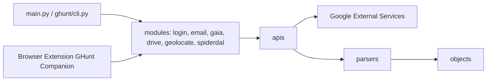

# mxrch/GHunt

> Command-line Python framework that queries Google services for OSINT purposes.

## The problem
Cross-referencing the public information that a Google account, a shared file or an identifier leaves behind requires manually calling several services and decoding their responses.

## What it actually does
A fully asynchronous CLI and Python library. The `email`, `gaia`, `drive`, `geolocate` and `spiderdal` modules call Google APIs, whose responses are parsed and then structured into objects; JSON export is possible. Authentication goes through the `ghunt login` command, with a browser extension (GHunt Companion) or by entering cookies. An online version exists (osint.industries).

## How it is wired


## Trying it
```bash
pip3 install pipx
pipx ensurepath
pipx install ghunt

ghunt login
ghunt email <email_address> --json user_data.json
```

## Cost and gotchas
Free; Python 3.10 minimum. A Google account is needed to authenticate. The listening mode of `login` is not compatible with Docker. For library use, the README asks for `pip3 install ghunt` rather than pipx.

## What it is not
The README states that the tool is for educational purposes, with no liability on the author, and limits use to personal or criminal investigations, penetration testing and open source projects, under AGPL. It depends on Google services that are undocumented for this use: it may therefore break without notice. It is not a tool for targeting third parties without a legal basis.

## Alternatives
- Online version osint.industries, mentioned in the README.

## For you
Ignore: very targeted OSINT use, dependent on Google and a single maintainer, unrelated to data/AI/MLOps work; license to be confirmed (AGPL announced, not recognized by GitHub).
