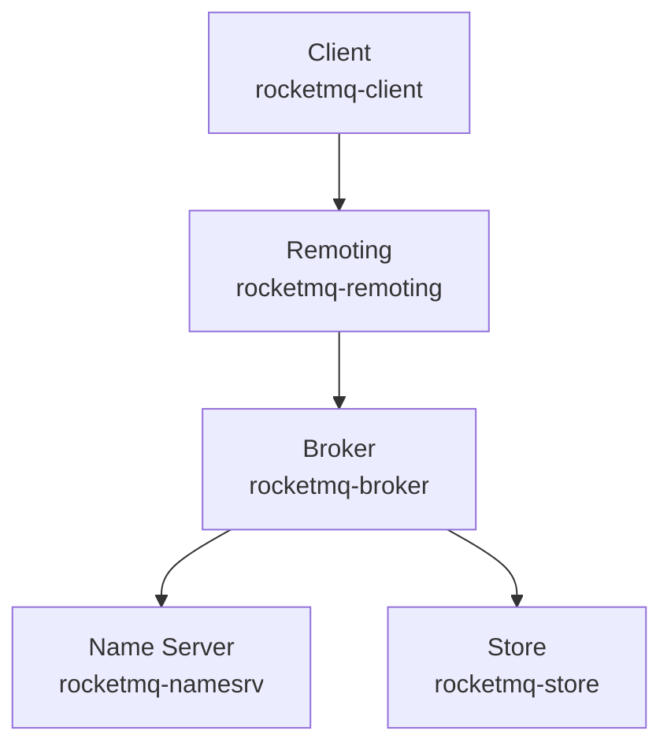

# mxsm/rocketmq-rust

> Unofficial community reimplementation of Apache RocketMQ in Rust, for those who want compatible messaging.

## The problem
A Java message broker requires a JVM and its garbage-collector pauses; Rust teams have no native RocketMQ-compatible equivalent.

## What it actually does
NameServer, Broker, Controller (OpenRaft) and gRPC Proxy, plus an asynchronous client SDK on Tokio. Local CommitLog and ConsumeQueue storage, with RocksDB and tiered storage as options. ACL, TLS, OpenTelemetry, admin CLI and TUI, dashboards and MCP servers.

## How it is wired


## Trying it
```bash
cargo run -p rocketmq-namesrv --bin rocketmq-namesrv-rust -- --rocketmqHome .rocketmq --bindAddress 127.0.0.1
cargo run -p rocketmq-broker --bin rocketmq-broker-rust -- -c .rocketmq/broker.toml
cargo run -p rocketmq-client-rust --example simple-producer
```

## Cost and gotchas
Rust 1.95.0, C/C++ toolchain, about 1.5 GB of disk for the Broker files. The quick start has no authentication or TLS. No performance figures published.

## What it is not
Not an official Apache release. The Controller does not join a Java quorum, DLedger is not supported and a Java data directory cannot be reused.

## Alternatives
- Apache RocketMQ: the original Java implementation, the baseline for comparison (5.5.0).

## For you
Ignore: a Rust message broker is of little use to a data / AI profile, unless you already operate RocketMQ.
