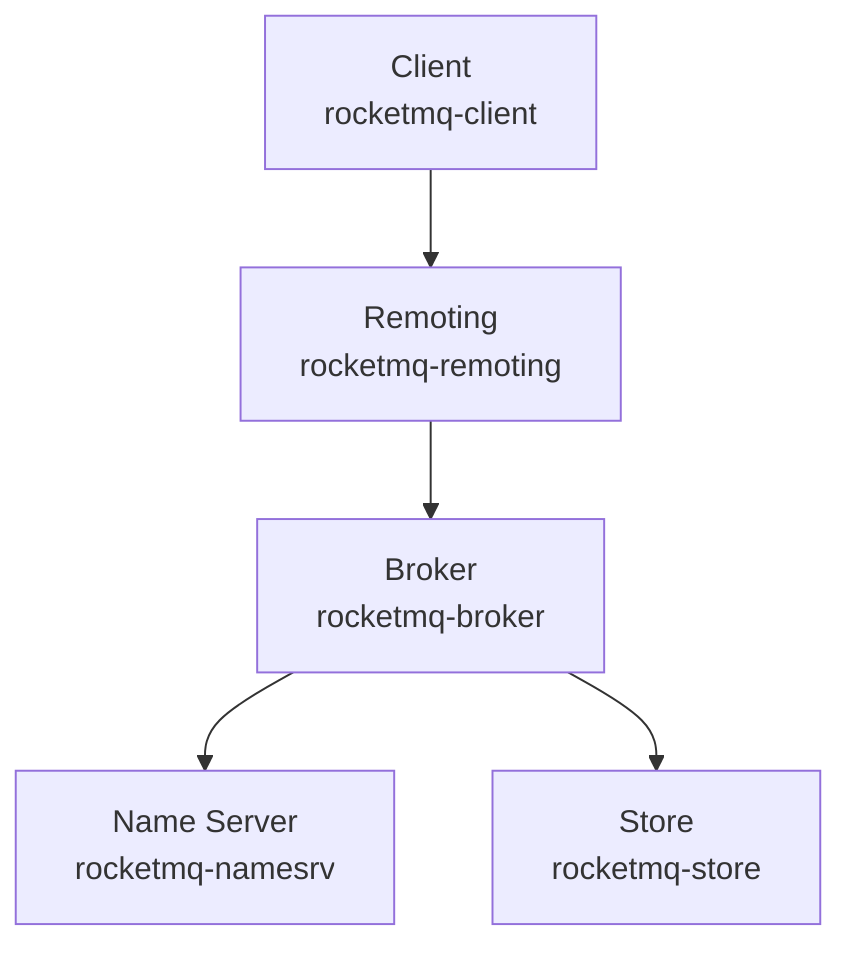

# mxsm/rocketmq-rust

> Réimplémentation communautaire non officielle d'Apache RocketMQ en Rust, pour qui veut une messagerie compatible.

## Le problème
Un courtier de messages Java demande une JVM et ses pauses de ramasse-miettes ; les équipes Rust n'ont pas d'équivalent natif compatible RocketMQ.

## Ce que ça fait vraiment
NameServer, Broker, Controller (OpenRaft) et Proxy gRPC, plus un SDK client asynchrone sur Tokio. Stockage local CommitLog et ConsumeQueue, avec RocksDB et stockage hiérarchisé en option. ACL, TLS, OpenTelemetry, CLI et TUI d'administration, tableaux de bord et serveurs MCP.

## Comment c'est branché


## Essayer
```bash
cargo run -p rocketmq-namesrv --bin rocketmq-namesrv-rust -- --rocketmqHome .rocketmq --bindAddress 127.0.0.1
cargo run -p rocketmq-broker --bin rocketmq-broker-rust -- -c .rocketmq/broker.toml
cargo run -p rocketmq-client-rust --example simple-producer
```

## Coût et pièges
Rust 1.95.0, chaîne C/C++, environ 1,5 Go de disque pour les fichiers du Broker. Le démarrage rapide n'a ni authentification ni TLS. Aucun chiffre de performance publié.

## Ce que ce n'est pas
Pas une version Apache officielle. Le Controller ne rejoint pas un quorum Java, DLedger n'est pas géré et un répertoire de données Java n'est pas réutilisable.

## Alternatives
- Apache RocketMQ : l'implémentation Java d'origine, base de comparaison (5.5.0).

## Pour toi
À ignorer : un courtier de messages Rust sert peu un profil data / IA, sauf si tu opères déjà RocketMQ.

