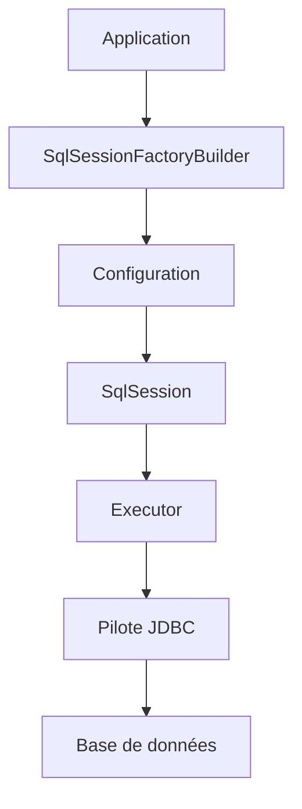

# mybatis/mybatis-3

> Java framework that maps objects to SQL queries or stored procedures via XML or annotations.

## The problem
Writing JDBC by hand is verbose, and a full ORM hides the SQL.

## What it actually does
A mapping layer between Java code and SQL. You describe queries in XML or annotations; MyBatis builds a configuration, opens a session, runs through an executor (simple, batch, cached) and converts rows into objects. Plugins intercept the key steps.

## How it is wired
Diagram based on the one provided, reduced.

## Trying it
No command documented in the README (it only covers contributions and tests).

## Cost and gotchas
Free (Apache-2.0). The real requirement is a JDK (versions 21 and 25 tested) and a JDBC driver. Some tests require Testcontainers, hence Docker.

## What it is not
Not an ORM: its simplicity comes precisely from hand-written SQL. Only useful in the Java ecosystem.

## Alternatives
No alternative named in the README (it only compares itself to ORM tools in general).

## For you
Ignore: SQL access layer for Java applications, of no interest to a Python data, AI or MLOps profile.
