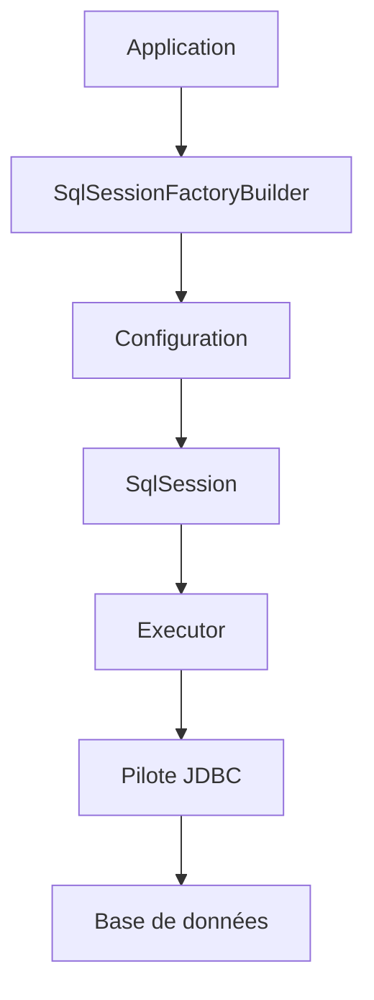

# mybatis/mybatis-3

> Framework Java qui associe objets et requêtes SQL ou procédures stockées via XML ou annotations.

## Le problème
Écrire du JDBC à la main est verbeux, et un ORM complet masque le SQL.

## Ce que ça fait vraiment
Une couche de mappage entre code Java et SQL. On décrit les requêtes en XML ou annotations ; MyBatis construit une configuration, ouvre une session, exécute via un exécuteur (simple, batch, avec cache) et convertit les lignes en objets. Des plugins interceptent les étapes clés.

## Comment c'est branché
Schéma d'après le diagramme fourni, réduit.

## Essayer
Aucune commande documentée dans le README (il ne parle que de contributions et de tests).

## Coût et pièges
Gratuit (Apache-2.0). Le besoin réel est un JDK (versions 21 et 25 testées) et un pilote JDBC. Certains tests exigent Testcontainers, donc Docker.

## Ce que ce n'est pas
Pas un ORM : la simplicité vient justement du SQL écrit à la main. Ne sert que dans l'écosystème Java.

## Alternatives
Aucune alternative nommée dans le README (il se compare seulement aux outils ORM en général).

## Pour toi
À ignorer : couche d'accès SQL pour applications Java, sans intérêt pour un profil data, IA ou MLOps en Python.

