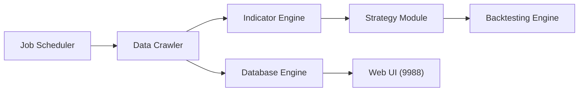

# myhhub/stock

> Quantitative analysis system for Chinese stocks: daily data, indicators, screening, backtesting.

## The problem
Fetch China A-share market data every day, compute indicators and candlestick patterns, then filter securities without assembling all of this yourself.

## What it actually does
Fetches stock and ETF data (fund flows, dividends, "dragon-tiger" list), computes about thirty indicators with TA-Lib and pandas, recognizes 61 candlestick patterns, computes cost distribution ("chips"), applies selection strategies and a backtest. Storage in a MySQL/MariaDB database, web interface on port 9988, scheduled tasks, optional automated trading (Windows).

## How it is wired


## Trying it
```bash
docker network create InStockService
docker run -d --name InStockDbService --network InStockService -v /data/mariadb/data:/var/lib/instockdb -e MYSQL_ROOT_PASSWORD=root library/mariadb:latest
docker run -dit --name InStock --network=InStockService -p 9988:9988 -e db_host=InStockDbService mayanghua/instock:latest
python execute_daily_job.py 2022-01-01 2022-03-01
```

## Cost and gotchas
Data is scraped from third-party sites (Eastmoney): proxies and a cookie must be supplied if blocked. The README admits that the interface's table uses a commercial component in evaluation version, and points to a cracking patch for Navicat: do not follow it. Investment disclaimer in the README.

## What it is not
Not financial advice. Automated trading triggers IPO subscriptions every day at 10 a.m. if the service is running.

## Alternatives
The README names no alternative.

## For you
Ignore: tool centered on the Chinese market, documented in Chinese, dependent on fragile scraping and a commercial component under an evaluation license.
