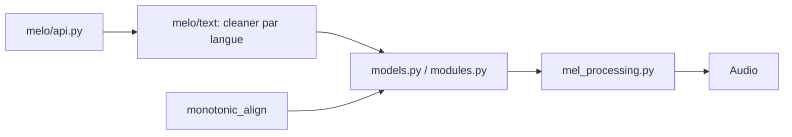

# myshell-ai/MeloTTS

> Multilingual speech synthesis library, fast enough to run in real time on CPU.

## The problem
Getting a quality synthetic voice in several languages without a GPU or a paid service.

## What it actually does
Synthesizes speech in English (several accents), Spanish, French, Chinese (with English mixing), Japanese, Korean. Python API, web interface and CLI, training on a custom dataset possible. The code describes per-language text processing, VITS-type models and an alignment module.

## How it is wired


## Trying it
```bash
# Aucune commande dans le README : liens vers les guides d'installation et d'usage
```

## Cost and gotchas
Free. Last push December 2024 and 232 open issues: weak maintenance.

## What it is not
Not voice cloning; the list of voices comes from the languages and accents provided.

## Alternatives
No alternative named in the README.

## For you
Keep an eye on it: lightweight multilingual TTS useful for a voice prototype, but maintenance has slowed.
