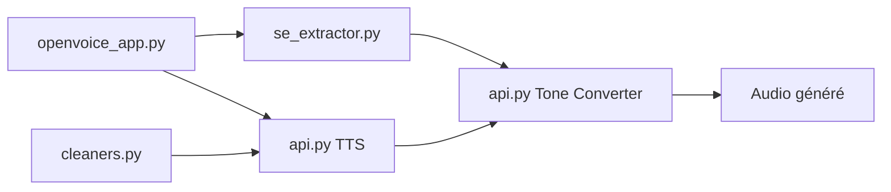

# myshell-ai/OpenVoice

> Voice timbre cloning and multilingual speech synthesis, for audio developers and researchers.

## The problem
Generating a voice resembling a reference, in several languages, without training a model per speaker.

## What it actually does
Takes a text and a reference audio, then returns audio with the cloned timbre, with style control (emotion, accent, rhythm, pauses). V2 supports English, Spanish, French, Chinese, Japanese and Korean. According to the code, the API exposes English/Chinese synthesis and timbre conversion; a demo application completes the whole. MIT, free commercial use.

## How it is wired

## Trying it
No command documented in this README: it points to a usage file and an FAQ.

## Cost and gotchas
Hardware requirements not specified; a GPU is likely for comfortable use, not documented. Last push in April 2025.

## What it is not
Not a hosted service. Voice cloning raises consent questions that this README does not address.

## Alternatives
No alternative named in the README.

## For you
Watch: useful for prototyping multilingual voice, but activity is old and the installation is for you to validate.
