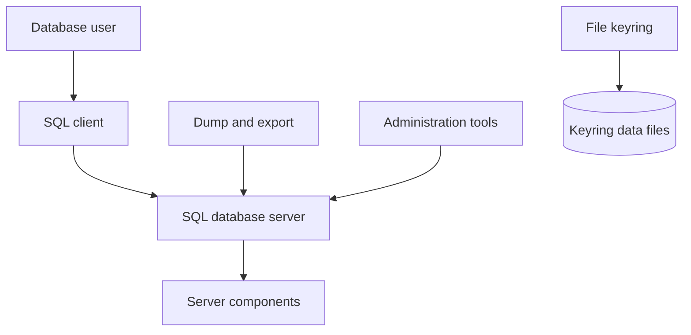

# mysql/mysql-server

> Source code of the MySQL SQL database server, published by Oracle.

## The problem
Having a relational SQL server and its client tools.

## What it actually does
The README only gives the Oracle copyright, the LICENSE file and documentation links. The code tree shows clients (`mysql`, `mysqldump`, `mysqlimport`, `mysqladmin`, `mysqlbinlog`), server components (connection control, telemetry, audit, backup, keyring) and the MySQL Router REST service. The implementation of the SQL engine is not in the excerpts.

## How it is wired

## Trying it
No command documented in the README.

## Cost and gotchas
License present but not identified by GitHub; the text refers to the LICENSE file. Build and dependencies are not described here.

## What it is not
Not an installation guide: the README is a mere rights notice.

## Alternatives
No alternative named in the README.

## For you
Ignore as a repository: reading the source code does not help; use MySQL through its distributions and official documentation.
