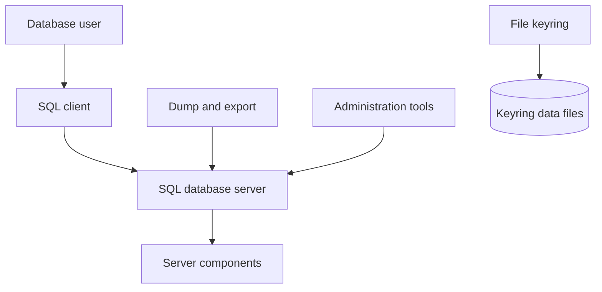

# mysql/mysql-server

> Code source du serveur de bases de données SQL MySQL, publié par Oracle.

## Le problème
Disposer d'un serveur SQL relationnel et de ses outils clients.

## Ce que ça fait vraiment
Le README indique seulement le copyright Oracle, le fichier LICENSE et des liens de documentation. L'arbre du code montre des clients (`mysql`, `mysqldump`, `mysqlimport`, `mysqladmin`, `mysqlbinlog`), des composants serveur (contrôle de connexion, télémétrie, audit, sauvegarde, keyring) et le service REST de MySQL Router. L'implémentation du moteur SQL n'est pas dans les extraits.

## Comment c'est branché

## Essayer
Aucune commande documentée dans le README.

## Coût et pièges
Licence présente mais non identifiée par GitHub ; le texte renvoie au fichier LICENSE. Compilation et dépendances non décrites ici.

## Ce que ce n'est pas
Ce n'est pas un guide d'installation : le README est un simple avis de droits.

## Alternatives
Aucune alternative nommée dans le README.

## Pour toi
À ignorer comme dépôt : lire le code source n'aide pas ; utilise MySQL via ses distributions et sa documentation officielle.

