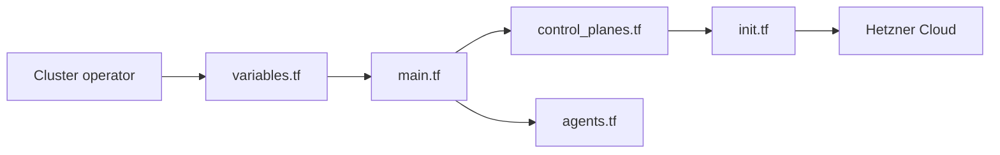

# mysticaltech/terraform-hcloud-kube-hetzner

> Terraform or OpenTofu module that deploys a k3s or RKE2 cluster on Hetzner Cloud.

## The problem
Hetzner offers no managed Kubernetes: standing up an HA cluster with network, firewall, storage, ingress and updates takes a lot of assembly.

## What it actually does
The module creates the servers (control planes, static agents, autoscaler pools), bootstraps them with k3s or RKE2 on openSUSE Leap Micro, then installs CSI, ingress, cert-manager and networking (Flannel, Calico or Cilium). Plan-time guardrails reject invalid topologies. A guide migrates v2 to v3, and scripts destroy or clean up a cluster.

## How it is wired


## Trying it
```sh
brew install opentofu kubectl hcloud
# Lancer createkh (script create.sh du dépôt), puis éditer kube.tf :
tofu init --upgrade
tofu plan
tofu apply
```

## Cost and gotchas
Hetzner account and a read-write API token, Packer for images. Server costs are on you. `cleanup.sh` treats the project as dedicated to the cluster: read its warning before use. Do not blindly apply a v2 to v3 migration.

## What it is not
Not a managed service, not affiliated with Hetzner (the README says so). Operating the cluster remains your responsibility.

## Alternatives
The README names no alternative.

## For you
Worth watching: interesting for hosting a training or serving cluster at low cost in Europe, but without a Kubernetes-on-Hetzner need it brings nothing.
