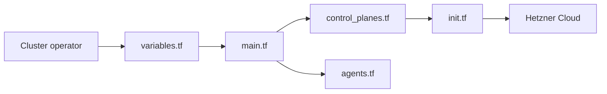

# mysticaltech/terraform-hcloud-kube-hetzner

> Module Terraform ou OpenTofu qui déploie un cluster k3s ou RKE2 sur Hetzner Cloud.

## Le problème
Hetzner n'offre pas de Kubernetes managé : monter un cluster HA avec réseau, firewall, stockage, ingress et mises à jour demande beaucoup d'assemblage.

## Ce que ça fait vraiment
Le module crée les serveurs (plans de contrôle, agents statiques, pools d'autoscaler), les amorce avec k3s ou RKE2 sur openSUSE Leap Micro, puis installe CSI, ingress, cert-manager et réseau (Flannel, Calico ou Cilium). Des garde-fous au plan refusent les topologies invalides. Un guide migre la v2 vers la v3, et des scripts détruisent ou nettoient un cluster.

## Comment c'est branché


## Essayer
```sh
brew install opentofu kubectl hcloud
# Lancer createkh (script create.sh du dépôt), puis éditer kube.tf :
tofu init --upgrade
tofu plan
tofu apply
```

## Coût et pièges
Compte Hetzner et jeton API en lecture-écriture, Packer pour les images. Le coût des serveurs est à ta charge. `cleanup.sh` traite le projet comme dédié au cluster : lire son avertissement avant usage. Ne pas appliquer à l'aveugle une migration v2 vers v3.

## Ce que ce n'est pas
Pas un service managé, pas affilié à Hetzner (le README le précise). L'exploitation du cluster reste à ta charge.

## Alternatives
Le README ne nomme pas d'alternative.

## Pour toi
Surveiller : intéressant pour héberger un cluster d'entraînement ou de service à faible coût en Europe, mais sans besoin Kubernetes sur Hetzner il n'apporte rien.

