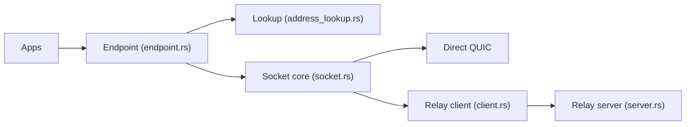

# n0-computer/iroh

> Rust library for connecting to a peer by its public key, directly or via a relay.

## The problem
Connecting two devices behind NATs requires hole-punching, relays and a discovery system.

## What it actually does
An `Endpoint` API to bind, dial a peer by public key and accept protocols. It first looks for a direct QUIC path (hole-punching, network probes, port mapping) and falls back to a public relay if needed, continuously choosing the best path. The workspace contains `iroh`, `iroh-relay`, `iroh-base` and `iroh-dns-server`. Protocols: iroh-blobs, iroh-gossip, iroh-docs.

## How it is wired


## Trying it
```bash
cargo add iroh
```
The README then gives the Rust example `Endpoint::bind()` / `connect` / `Router::builder` (connecting side, then accepting side).

## Cost and gotchas
Free. The public relays and DNS service are run by the team, but you can host your own. The README does not quantify service guarantees.

## What it is not
Not a VPN nor a finished file-sharing tool: it is a networking building block. Use outside Rust goes through separate bindings (iroh-ffi).

## Alternatives
No alternative named in the README.

## For you
Watch: a P2P building block useful for synchronizing data or models between machines without a central server; still young.
