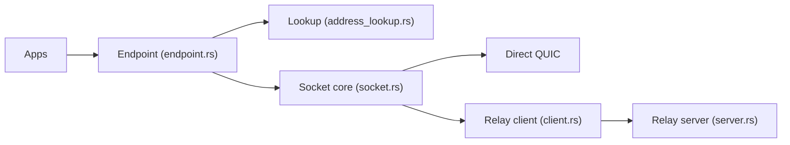

# n0-computer/iroh

> Bibliothèque Rust pour se connecter à un pair par sa clé publique, en direct ou via un relais.

## Le problème
Connecter deux appareils derrière des NAT demande du hole-punching, des relais et un système de découverte.

## Ce que ça fait vraiment
Une API `Endpoint` pour se lier, composer un pair par clé publique et accepter des protocoles. Elle cherche d'abord un chemin QUIC direct (hole-punching, sondes réseau, port mapping) et bascule sur un relais public si besoin, en choisissant en continu le meilleur chemin. Le workspace contient `iroh`, `iroh-relay`, `iroh-base` et `iroh-dns-server`. Protocoles : iroh-blobs, iroh-gossip, iroh-docs.

## Comment c'est branché


## Essayer
```bash
cargo add iroh
```
Le README donne ensuite l'exemple Rust `Endpoint::bind()` / `connect` / `Router::builder` (côté connexion puis côté acceptation).

## Coût et pièges
Gratuit. Les relais et le service DNS publics sont gérés par l'équipe, mais tu peux héberger les tiens. Le README ne chiffre pas les garanties de service.

## Ce que ce n'est pas
Pas un VPN ni un outil de partage de fichiers fini : c'est une brique réseau. L'usage hors Rust passe par des bindings séparés (iroh-ffi).

## Alternatives
Aucune alternative nommée dans le README.

## Pour toi
À surveiller : brique P2P utile pour synchroniser données ou modèles entre machines sans serveur central ; encore jeune.

