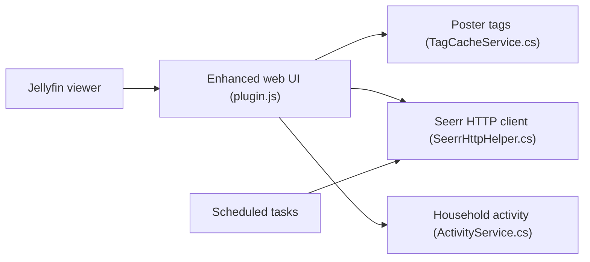

# n00bcodr/Jellyfin-Enhanced

> Jellyfin plugin that adds shortcuts, tags, Seerr and *arr integration, for media server administrators.

## The problem
Jellyfin's interface lacks comfort features: bookmarks, content hiding, media requests, calendar.

## What it actually does
- Keyboard shortcuts, bookmarks, pause screen, intro skip (via a third-party plugin).
- Per-user hidden content, spoiler protection applied server-side.
- Requests through Seerr, Sonarr/Radarr links and calendar, quality and language tags.
- Requires Jellyfin 10.11 or later; not supported on Android TV.

## How it is wired

## Trying it
In Jellyfin: Dashboard, Plugins, Repositories, add
`https://raw.githubusercontent.com/n00bcodr/jellyfin-plugins/main/manifest.json`, then Catalog, install, restart.

## Cost and gotchas
Free; the Seerr and *arr features require those services. The File Transformation plugin is recommended.

## What it is not
Not a media server; not compatible with native applications that have no web interface.

## Alternatives
The README recommends Custom Tabs, Plugin Pages and Kefin Tweaks as complements.

## For you
Ignore: personal media-center comfort, unrelated to data/AI/MLOps.
