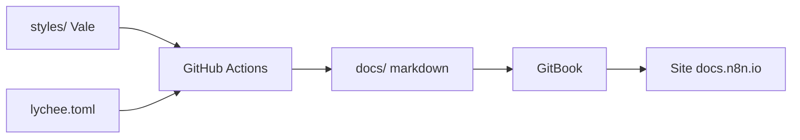

# n8n-io/n8n-docs

> Sources of the official n8n documentation, for contributors who fix or complete the pages.

## The problem
The documentation of an automation tool must be versioned, reviewed and checked (links, style) like code.

## What it actually does
Contains the markdown pages in `docs/`, document templates, Vale rules (prose linting) and the Lychee config (broken links). The GitHub Actions CI runs Vale and Lychee. No local preview: GitBook adds a preview link to each PR. The generated architecture mentions MkDocs, which the README contradicts (GitBook).

## How it is wired


## Trying it
```bash
# Aucune commande documentée : pas d'aperçu local.
# Pousser une branche et ouvrir une pull request ; GitBook ajoute un lien de preview.
```

## Cost and gotchas
Free. No local build, so every attempt goes through a PR.

## What it is not
It is not the n8n code nor a tool to install. A license is present but not identified by GitHub.

## Alternatives
The n8n repo (product code), cited in the README.

## For you
Ignore unless you contribute to the n8n docs: it is content, not a tool, and it is read at docs.n8n.io.
