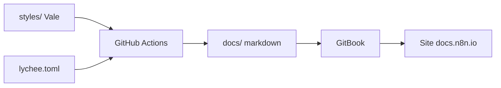

# n8n-io/n8n-docs

> Sources de la documentation officielle de n8n, pour contributeurs qui corrigent ou complètent les pages.

## Le problème
La documentation d'un outil d'automatisation doit être versionnée, relue et vérifiée (liens, style) comme du code.

## Ce que ça fait vraiment
Contient les pages markdown dans `docs/`, des modèles de documents, des règles Vale (linting de prose) et la config Lychee (liens cassés). La CI GitHub Actions lance Vale et Lychee. Aucun aperçu local : GitBook ajoute un lien de prévisualisation à chaque PR. L'architecture générée parle de MkDocs, ce que le README contredit (GitBook).

## Comment c'est branché


## Essayer
```bash
# Aucune commande documentée : pas d'aperçu local.
# Pousser une branche et ouvrir une pull request ; GitBook ajoute un lien de preview.
```

## Coût et pièges
Gratuit. Pas de build local, donc chaque essai passe par une PR.

## Ce que ce n'est pas
Ce n'est pas le code de n8n ni un outil à installer. Licence présente mais non identifiée par GitHub.

## Alternatives
Le dépôt n8n (code du produit), cité dans le README.

## Pour toi
À ignorer sauf si tu contribues à la doc n8n : c'est un contenu, pas un outil, et il se lit sur docs.n8n.io.

