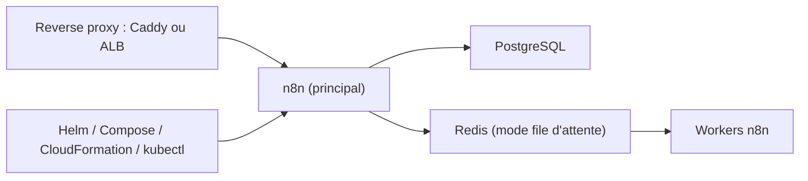

# n8n-io/n8n-hosting

> Official configurations for self-hosting n8n: Helm, Docker Compose, CloudFormation and Kubernetes manifests.

## The problem
Deploying n8n beyond a single container (PostgreSQL database, Redis, workers, HTTPS) requires building the infrastructure without a reference model.

## What it actually does
The repository gathers ready-to-adapt examples: a Helm chart for Kubernetes, Compose files (n8n + PostgreSQL, queue mode with Redis and a worker, subfolder behind SSL, Caddy), an ECS Fargate CloudFormation template (multi-main, RDS, ElastiCache, S3, ALB, worker autoscaling) and raw Kubernetes manifests for AWS, Azure and GCP tutorials.

## How it is wired
Simplified diagram based on the sheet, no diagram provided.



## Trying it
```bash
helm install n8n oci://ghcr.io/n8n-io/n8n-helm-chart/n8n -f my-values.yaml
```

## Cost and gotchas
Free on the repository side; the infrastructure (Kubernetes, RDS, ElastiCache, ALB) is billed by your provider. The Compose files and manifests are examples to harden (secrets, backups): the README says nothing about this.

## What it is not
It is not n8n itself, only its deployment. n8n's license is not covered here. The raw manifests are tutorial supports, not a turnkey installation.

## Alternatives
No alternative mentioned in the README.

## For you
Adopt it if you run n8n to automate data or AI flows: it is the official reference, with queue mode and an AWS template ready to reuse.
