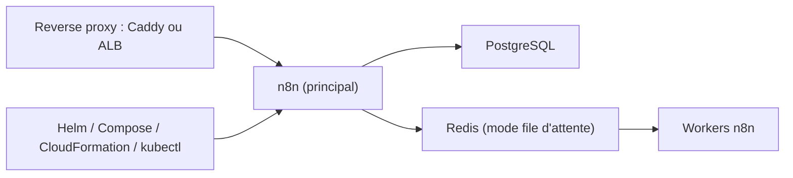

# n8n-io/n8n-hosting

> Configurations officielles pour auto-héberger n8n : Helm, Docker Compose, CloudFormation et manifestes Kubernetes.

## Le problème
Déployer n8n au-delà d'un conteneur seul (base PostgreSQL, Redis, workers, HTTPS) demande de monter l'infrastructure sans modèle de référence.

## Ce que ça fait vraiment
Le dépôt regroupe des exemples prêts à adapter : un chart Helm pour Kubernetes, des Compose (n8n + PostgreSQL, mode file d'attente avec Redis et worker, sous-dossier derrière SSL, Caddy), un modèle CloudFormation ECS Fargate (multi-main, RDS, ElastiCache, S3, ALB, autoscaling des workers) et des manifestes Kubernetes bruts pour des tutoriels AWS, Azure et GCP.

## Comment c'est branché
Schéma simplifié d'après la fiche, sans diagramme fourni.



## Essayer
```bash
helm install n8n oci://ghcr.io/n8n-io/n8n-helm-chart/n8n -f my-values.yaml
```

## Coût et pièges
Gratuit côté dépôt ; l'infrastructure (Kubernetes, RDS, ElastiCache, ALB) est facturée par ton fournisseur. Les Compose et manifestes sont des exemples à durcir (secrets, sauvegardes) : le README n'en dit rien.

## Ce que ce n'est pas
Ce n'est pas n8n lui-même, seulement son déploiement. La licence de n8n n'est pas traitée ici. Les manifestes bruts sont des supports de tutoriels, pas une installation clé en main.

## Alternatives
Aucune alternative citée dans le README.

## Pour toi
À adopter si tu fais tourner n8n pour automatiser des flux data ou IA : c'est la référence officielle, avec le mode file d'attente et un modèle AWS prêts à reprendre.

