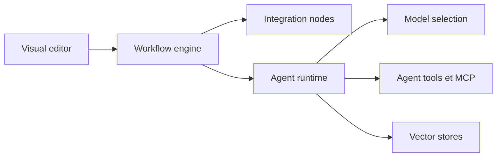

# n8n-io/n8n

> "Fair-code" platform for workflow and AI agent automation, self-hosted, designed for technical teams.

## The problem
Manually connecting dozens of APIs and models requires fragile, copy-pasted code. It also involves tracing, validating, and re-running these chains.

## What it actually does
A visual editor assembles nodes (over 1,500 integrations announced) into workflows, using JavaScript or Python when the visual interface is insufficient. An AI layer adds agents, tools, memory, vector databases, MCP connections, and model provider choices. Safeguards, workflow review, observability, and access control are described. The details of the engine have not been sampled: it is undocumented.

## How it is wired


## Trying it
```bash
curl -fsSL https://get.n8n.io | sh
docker volume create n8n_data
docker run -it --rm --name n8n -p 5678:5678 -v n8n_data:/home/node/.n8n docker.n8n.io/n8nio/n8n
```
Available at http://localhost:5678.

## Cost and gotchas
Docker is required. OpenAI, Anthropic, or Google models remain your responsibility. The cloud offering is paid; the "fair-code" license is not recognized by GitHub.

## What it is not
Not a typical open-source license: intended for review before commercial use. Not a data pipeline orchestrator or an MLOps tool. The 1,193 open issues indicate a significant scope of work.

## Alternatives
No alternative is specified in the README file.

## For you
Ideal for quickly prototyping agents and automation solutions for your models, provided you verify the license before using them in a business setting.
