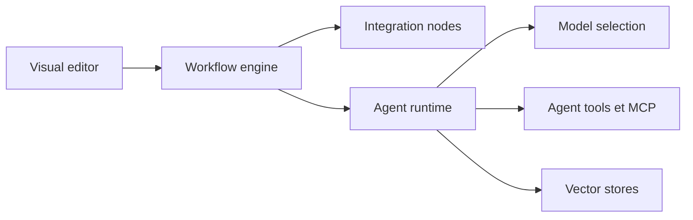

# n8n-io/n8n

> Plateforme « fair-code » d'automatisation de workflows et d'agents IA, auto-hébergeable, pour équipes techniques.

## Le problème
Relier des dizaines d'API et de modèles à la main demande du code de colle fragile. Il faut aussi tracer, valider et rejouer ces enchaînements.

## Ce que ça fait vraiment
Un éditeur visuel assemble des nœuds (plus de 1 500 intégrations annoncées) en workflows, avec du JavaScript ou Python quand le visuel ne suffit pas. Une couche IA ajoute agents, outils, mémoire, magasins vectoriels, connexion MCP et choix du fournisseur de modèle. Garde-fous, revue de workflows, observabilité et contrôle d'accès sont décrits. Le détail du moteur n'a pas été échantillonné : non documenté.

## Comment c'est branché


## Essayer
```bash
curl -fsSL https://get.n8n.io | sh
docker volume create n8n_data
docker run -it --rm --name n8n -p 5678:5678 -v n8n_data:/home/node/.n8n docker.n8n.io/n8nio/n8n
```
Éditeur sur http://localhost:5678.

## Coût et pièges
Docker requis. Les modèles OpenAI, Anthropic ou Google restent à ta charge. L'offre cloud est payante ; la licence « fair-code » n'est pas identifiée par GitHub.

## Ce que ce n'est pas
Pas une licence open source classique : à lire avant un usage commercial. Pas un orchestrateur de pipelines de données ni un outil MLOps. Les 1 193 issues ouvertes disent que la surface est large.

## Alternatives
Aucune alternative nommée dans le README.

## Pour toi
À adopter pour prototyper vite des agents et des automatisations branchées sur tes modèles, à condition de vérifier la licence avant tout usage en entreprise.

