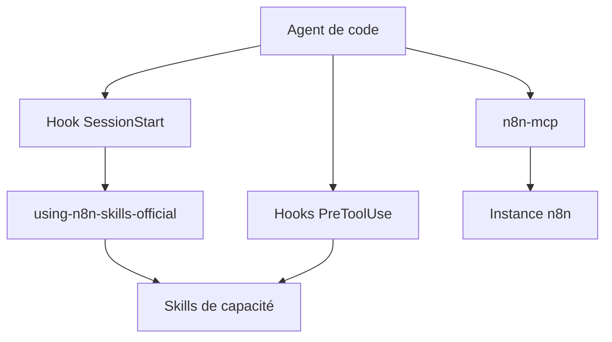

# n8n-io/skills

> Official n8n plugin: 14 skills and hooks so a coding agent builds workflows through the MCP.

## The problem
An agent connected to n8n's MCP knows how to call the tools, but not the best practices: expressions, loops, error handling, credentials. Workflows come out wrong on the first try.

## What it actually does
- Installs 14 capability skills plus an entry meta-skill, as plain markdown files.
- A SessionStart hook loads the protocol and a reference of the MCP tools at each session.
- PreToolUse hooks remind the agent of the relevant skill before high-impact MCP calls.
- The Claude Code plugin bundles the `n8n-mcp` connection and asks for the instance URL.

## How it is wired

Simplified diagram based on the sheet, no diagram provided.

## Trying it
```bash
/plugin marketplace add n8n-io/skills
/plugin install n8n-skills@n8n-io
/reload-plugins
npx skills add n8n-io/skills
```

## Cost and gotchas
You need an n8n instance (Cloud or self-hosted) at version 2.2.0 minimum, with the instance MCP enabled. Without the plugin, the snippet to add to `AGENTS.md` is required, since there is no startup hook.

## What it is not
It is not the MCP server: it brings guidance, not capabilities. The skills are useless without an n8n instance. Compatibility varies outside Claude Code, Codex and OpenCode.

## Alternatives
No alternative named in the README.

## For you
Worth watching: useful only if you drive n8n with a coding agent; the project is young (April 2026) but backed by the vendor itself.
