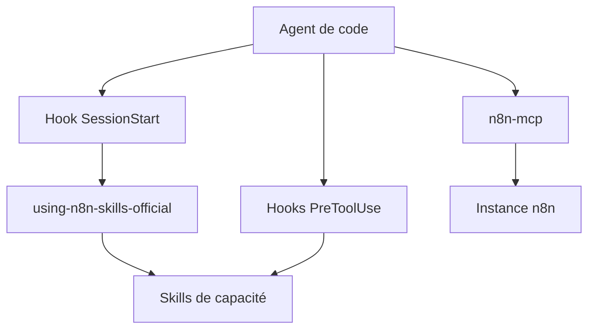

# n8n-io/skills

> Plugin officiel n8n : 14 skills et hooks pour qu'un agent de code construise des workflows via le MCP.

## Le problème
Un agent branché au MCP de n8n sait appeler les outils, mais pas les bonnes pratiques : expressions, boucles, gestion d'erreurs, credentials. Les workflows sortent faux au premier essai.

## Ce que ça fait vraiment
- Installe 14 skills de capacité plus un méta-skill d'entrée, en simples fichiers markdown.
- Un hook SessionStart charge le protocole et une référence des outils MCP à chaque session.
- Des hooks PreToolUse rappellent le skill concerné avant les appels MCP à fort impact.
- Le plugin Claude Code embarque la connexion `n8n-mcp` et demande l'URL de l'instance.

## Comment c'est branché

Schéma simplifié d'après la fiche, sans diagramme fourni.

## Essayer
```bash
/plugin marketplace add n8n-io/skills
/plugin install n8n-skills@n8n-io
/reload-plugins
npx skills add n8n-io/skills
```

## Coût et pièges
Il faut une instance n8n (Cloud ou auto-hébergée) en version 2.2.0 minimum, avec le MCP d'instance activé. Sans le plugin, l'extrait à ajouter à `AGENTS.md` est nécessaire, faute de hook de démarrage.

## Ce que ce n'est pas
Ce n'est pas le serveur MCP : il apporte des consignes, pas de capacités. Les skills ne servent à rien sans instance n8n. Compatibilité variable hors Claude Code, Codex et OpenCode.

## Alternatives
Aucune alternative nommée dans le README.

## Pour toi
À surveiller : utile seulement si tu pilotes n8n avec un agent de code ; le projet est jeune (avril 2026) mais porté par l'éditeur lui-même.

