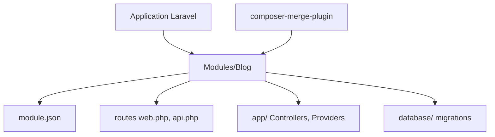

# nWidart/laravel-modules

> Laravel package that splits a large application into self-contained modules, for PHP developers.

## The problem
A large Laravel application quickly becomes a single block where everything is mixed together.

## What it actually does
Each module lives in `Modules/` with its own routes, controllers, models, views, migrations and config. Artisan commands generate them. A module can be enabled or disabled, with the state kept by default in a JSON file.

## How it is wired


## Trying it
```bash
composer require nwidart/laravel-modules
php artisan module:make Blog
php artisan module:list
php artisan module:disable Blog
php artisan module:enable Blog
```

## Cost and gotchas
Free. The current version requires PHP 8.3+ and Laravel 13 (a need outside the list of prerequisites). The Composer plugin `wikimedia/composer-merge-plugin` must be allowed, otherwise the modules are not loaded.

## What it is not
It is not a microservices architecture: the modules remain within a single Laravel deployment.

## Alternatives
- pingpong/modules: the ancestor, which is no longer maintained.

## For you
Ignore: a PHP/Laravel tool unrelated to a data / AI / MLOps profile.
