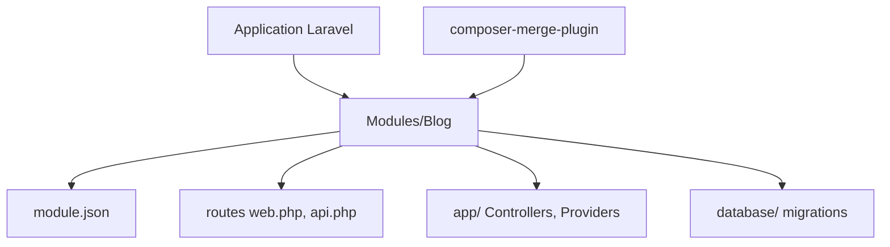

# nWidart/laravel-modules

> Package Laravel qui découpe une grosse application en modules autonomes, pour les développeurs PHP.

## Le problème
Une grande application Laravel devient vite un bloc unique où tout est mélangé.

## Ce que ça fait vraiment
Chaque module vit dans `Modules/` avec ses routes, contrôleurs, modèles, vues, migrations et config. Des commandes Artisan les génèrent. Un module peut être activé ou désactivé, l'état étant gardé par défaut dans un fichier JSON.

## Comment c'est branché


## Essayer
```bash
composer require nwidart/laravel-modules
php artisan module:make Blog
php artisan module:list
php artisan module:disable Blog
php artisan module:enable Blog
```

## Coût et pièges
Gratuit. Il faut PHP 8.3+ et Laravel 13 pour la version courante (besoin hors liste de prérequis). Le plugin Composer `wikimedia/composer-merge-plugin` doit être autorisé, sinon les modules ne sont pas chargés.

## Ce que ce n'est pas
Ce n'est pas une architecture de microservices : les modules restent dans un seul déploiement Laravel.

## Alternatives
- pingpong/modules : l'ancêtre, qui n'est plus maintenu.

## Pour toi
À ignorer : outil PHP/Laravel sans rapport avec un profil data / IA / MLOps.

