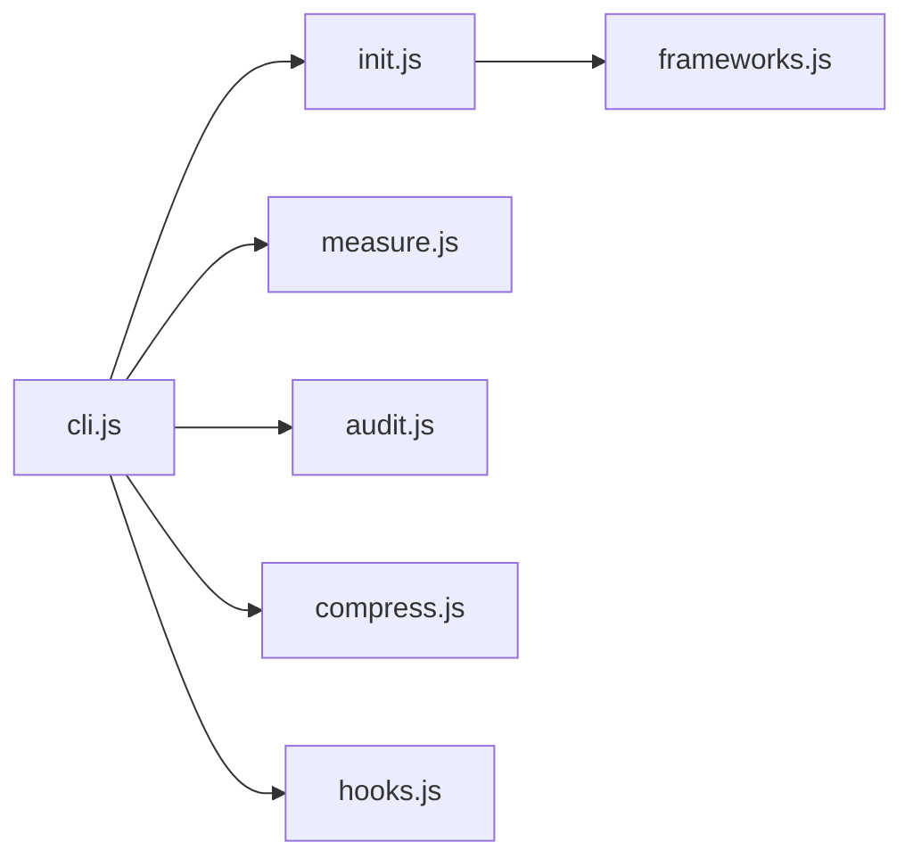

# nadimtuhin/claude-token-optimizer

> CLI that structures a project's documentation so that Claude Code loads fewer tokens at startup.

## The problem
Claude Code loads all docs at startup: the author measured 11,000 tokens consumed before coding.

## What it actually does
`cto init` detects the framework and creates CLAUDE.md, .claudeignore, `.claude/` and `docs/learnings/`. Commands `measure`, `audit` (19 checks, usable in CI), `compress`, `prune`, `diff`, `watch`. Provides hook templates (read guard, keyword-based context injection, session snapshot). Token estimates are based on the Claude 2 tokenizer.

## How it is wired


## Trying it
```bash
npx claude-token-optimizer measure
npx claude-token-optimizer init
cto audit --json
cto hooks install --all
```

## Cost and gotchas
Free. The figures (11,000 → 1,300) come from one of the author's projects; the gain varies.

## What it is not
Not an exact measure of billed tokens. Does not optimize code, only the loaded docs.

## Alternatives
- Claude Workflows: complementary, optimizes processes rather than docs.

## For you
Adopt on a trial basis: `measure` costs little and quickly reveals the context waste of a large CLAUDE.md.
