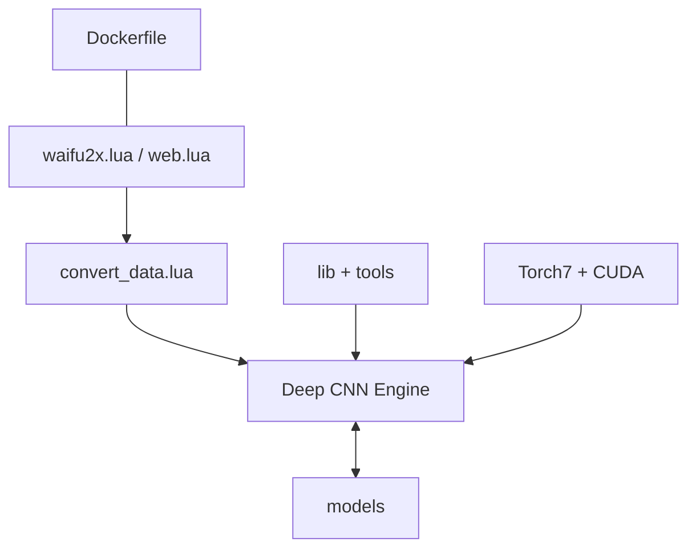

# nagadomi/waifu2x

> Upscales and denoises images (anime, photos) with a CNN on Torch7, from the command line or the web.

## The problem
Enlarge an image while keeping edges sharp, without the blur of classic interpolation.

## What it actually does
Three modes: noise reduction, 2× upscaling, or both. Usable via `waifu2x.lua`, in batch (file list) or through a local web server on port 8812. A "photo" model exists. It also lets you train your own models. Development has moved to the nunif repository (PyTorch version).

## How it is wired


## Trying it
```bash
th waifu2x.lua
th waifu2x.lua -m noise_scale -noise_level 1 -i input_image.png -o output_image.png
th web.lua
docker run --gpus all -p 8812:8812 waifu2x th web.lua
```

## Cost and gotchas
NVIDIA GPU and CUDA required; old Torch7 stack (Ubuntu 16.04, CUDA 7.5 in the README). Docker without a JIT cache is very slow.

## What it is not
Not the maintained version: the README points to nunif. Not a simple install: Torch7 and LuaRocks are required.

## Alternatives
- nunif: the PyTorch successor, pointed to by the author.
- waifu2x-caffe: recommended on Windows (binary).
- waifu2x-ncnn-vulkan: also recommended, without CUDA.

## For you
Ignore: abandoned Torch7 stack (last push 2023); better to start from the successor nunif if you want super-resolution.
