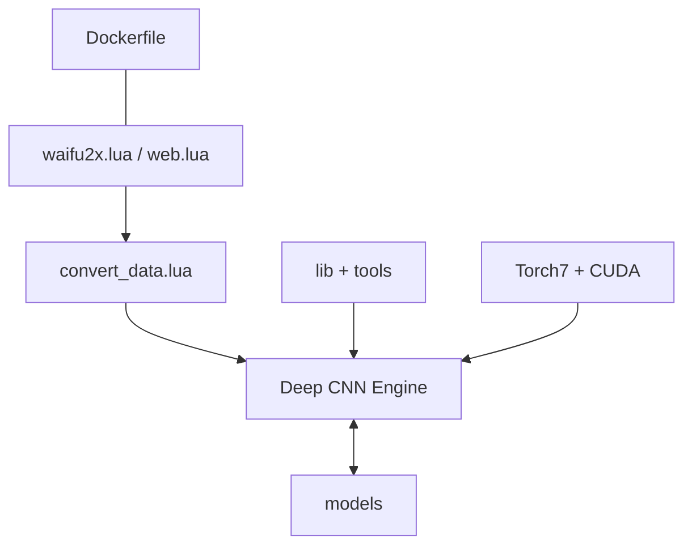

# nagadomi/waifu2x

> Agrandit et débruite des images (anime, photos) avec un CNN sous Torch7, en ligne de commande ou en web.

## Le problème
Agrandir une image en gardant les contours nets, sans le flou de l'interpolation classique.

## Ce que ça fait vraiment
Trois modes : réduction de bruit, agrandissement ×2, ou les deux. Utilisable via `waifu2x.lua`, en lot (liste de fichiers) ou via un serveur web local sur le port 8812. Un modèle « photo » existe. Il permet aussi d'entraîner ses propres modèles. Le développement a migré vers le dépôt nunif (version PyTorch).

## Comment c'est branché


## Essayer
```bash
th waifu2x.lua
th waifu2x.lua -m noise_scale -noise_level 1 -i input_image.png -o output_image.png
th web.lua
docker run --gpus all -p 8812:8812 waifu2x th web.lua
```

## Coût et pièges
GPU NVIDIA et CUDA obligatoires ; stack Torch7 ancienne (Ubuntu 16.04, CUDA 7.5 dans le README). Docker sans cache JIT très lent.

## Ce que ce n'est pas
Pas la version maintenue : le README renvoie vers nunif. Pas d'installation simple : Torch7 et LuaRocks sont requis.

## Alternatives
- nunif : le successeur PyTorch, indiqué par l'auteur.
- waifu2x-caffe : recommandé sous Windows (binaire).
- waifu2x-ncnn-vulkan : recommandé aussi, sans CUDA.

## Pour toi
À ignorer : stack Torch7 abandonnée (dernier push 2023), mieux vaut partir du successeur nunif si tu veux de la super-résolution.

