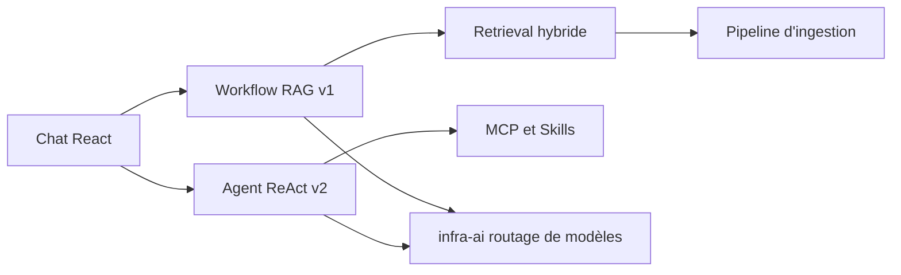

# nageoffer/ragent

> End-to-end Agentic RAG platform in Java, designed as a reference project for backend developers.

## The problem
RAG demos stop at "embedding + top-k + LLM" and show no routing, fault tolerance or traceability.

## What it actually does
Modular monolith with seven Maven modules and a React console. V1 is a fixed RAG workflow: question rewriting, tree-shaped intents, vector/keyword/graph/web search merged by RRF and Rerank. V2 adds a ReAct engine (AgentScope), MCP tools, skills, session memory and human confirmation of writes. Model routing with circuit breaker, Redis queue, Langfuse traces.

## How it is wired


## Trying it
```bash
# Aucune commande dans le README fourni :
# voir la documentation officielle « 快速启动 » (démarrage rapide)
```

## Cost and gotchas
Heavy stack: Spring Boot 4, Redis, RocketMQ, a database, a vector store. Model provider keys at your expense. Documentation mostly in Chinese.

## What it is not
Not a lightweight library: it is a complete application, to be read as a study source. The promotional text (CV, interviews) says nothing about the code itself.

## Alternatives
- Spring AI and LangChain4j: the README explains why it does not adopt them.

## For you
Worth watching: interesting for studying a complete RAG and Agent architecture in Java, but the deployment effort and the language barrier limit direct use.
