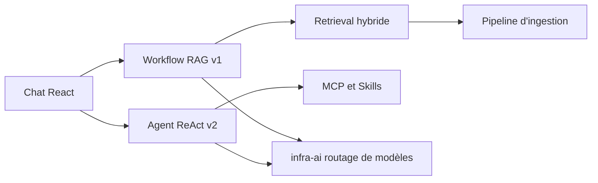

# nageoffer/ragent

> Plateforme Java d'Agentic RAG de bout en bout, pensée comme projet de référence pour développeurs backend.

## Le problème
Les démos RAG s'arrêtent à « embedding + top-k + LLM » et ne montrent ni routage, ni tolérance aux pannes, ni traçabilité.

## Ce que ça fait vraiment
Monolithe modulaire à sept modules Maven et console React. V1 est un workflow RAG fixe : réécriture de question, intentions en arbre, recherche vectorielle/mots-clés/graphe/web fusionnée par RRF et Rerank. V2 ajoute un moteur ReAct (AgentScope), outils MCP, skills, mémoire de session et confirmation humaine des écritures. Routage de modèles avec disjoncteur, file Redis, traces Langfuse.

## Comment c'est branché


## Essayer
```bash
# Aucune commande dans le README fourni :
# voir la documentation officielle « 快速启动 » (démarrage rapide)
```

## Coût et pièges
Pile lourde : Spring Boot 4, Redis, RocketMQ, base de données, magasin vectoriel. Clés des fournisseurs de modèles à ta charge. Documentation majoritairement en chinois.

## Ce que ce n'est pas
Pas une bibliothèque légère : c'est une application complète, à lire comme source d'étude. Le texte promotionnel (CV, entretiens) ne dit rien du code lui-même.

## Alternatives
- Spring AI et LangChain4j : le README explique pourquoi il ne les adopte pas.

## Pour toi
À surveiller : intéressant pour étudier une architecture RAG et Agent complète en Java, mais l'effort de déploiement et la barrière de la langue limitent l'usage direct.

