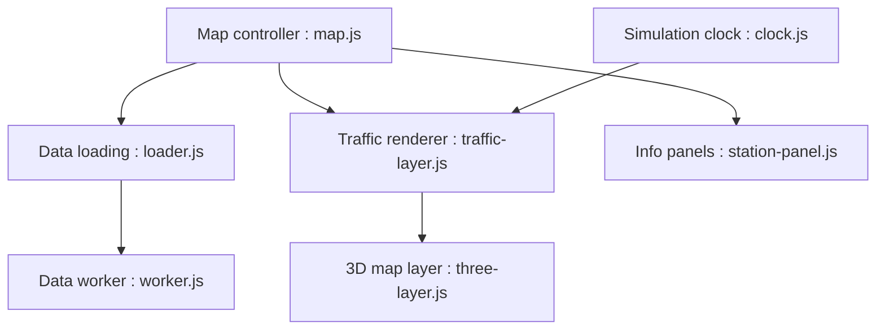

# nagix/mini-tokyo-3d

> Real-time 3D map of Tokyo's public transport, in the browser.

## The problem
Viewing the trains and planes of the Tokyo region live on a map.

## What it actually does
Loads static data and timetables, refreshes vehicle positions and renders them with Mapbox and Three.js (motion computed on GPU textures). Route search, underground mode, delayed playback, train tracking. The data comes from the Public Transportation Open Data Center.

## How it is wired


## Trying it
```bash
npm install
MAPBOX_ACCESS_TOKEN=<token> MT3D_SECRET_ODPT=<token> MT3D_SECRET_CHALLENGE=<token> npm run build-all
```

## Cost and gotchas
To rebuild, you need Mapbox and ODPT tokens (two tokens at ODPT). An online demo exists to try it without configuring anything.

## What it is not
Not a general-purpose mapping tool: centered on Japanese transport data.

## Alternatives
No alternative named in the README.

## For you
Worth watching: a reference example of real-time visualization (open data, GPU rendering), to read rather than deploy.
