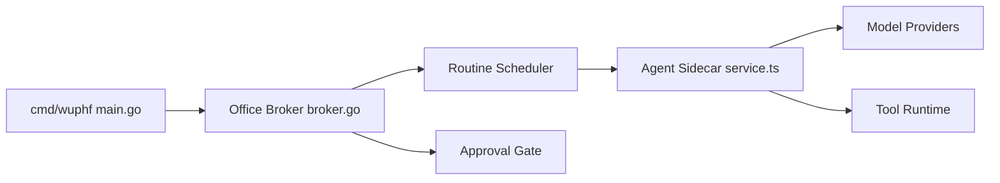

# najmuzzaman-mohammad/gawkbot

> Local office of AI bots that turn a workflow described in one sentence into a supervised micro-application.

## The problem
Automating manual tasks (CRM, emails, messages) with an agent means building the interface, routines and safeguards yourself.

## What it actually does
You describe a workflow; a bot is built live with an interface, scheduled routines (cron, versioned prompts), tools, cited knowledge pages, typed tables and over 1,200 integrations. It relies on an already connected bot CLI (Claude Code by default, Codex, Opencode, Ollama, Hermes, OpenClaw). Every external write waits for an approval click.

## How it is wired


## Trying it
```bash
npx gawkbot
npm install -g gawkbot && gawkbot
gawkbot share
```

## Cost and gotchas
Free, but model calls are at your expense (one bot costs 1 to 2 dollars on Claude Code). Composio, hosted, is used for integrations. Analytics and session recording are enabled by default but inactive without a PostHog key.

## What it is not
Not open-source software in the OSI sense: Sustainable Use license, not identified by GitHub. The README calls itself open source, announces "bot computers" in a local VM, then specifies "not yet". The tone is partly parodic.

## Alternatives
Rakazo, OpenMausBot and OpenBot, cited in the README as other open alternatives.

## For you
Ignore: young, non-standard license, contradictory README, and the gain remains unclear compared with what a coding agent does alone.
