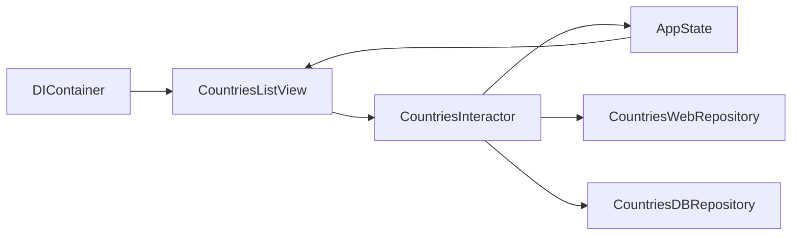

# nalexn/clean-architecture-swiftui

> iOS demo application showing a Clean Architecture with SwiftUI and Combine.

## The problem
Structuring a SwiftUI app without putting business logic in the views.

## What it actually does
A sample app lists countries via the restcountries.com API. Three layers: SwiftUI views without logic, Interactors (business logic, which write to a central `AppState`), Repositories (web and SwiftData database). Injection through `@Environment`, programmatic navigation, deep links, networking in async/await, tests including UI (ViewInspector). An `mvvm` branch offers the MVVM variant.

## How it is wired

## Trying it
No documented command: open the project in Xcode and run the app.

## Cost and gotchas
Free. Requires macOS and Xcode; last push July 2025.

## What it is not
Not a reusable library: an example to read or copy.

## Alternatives
None named in the README (mention of an MVVM branch of the same repository).

## For you
Ignore: pure iOS development, unrelated to data/AI/MLOps.
