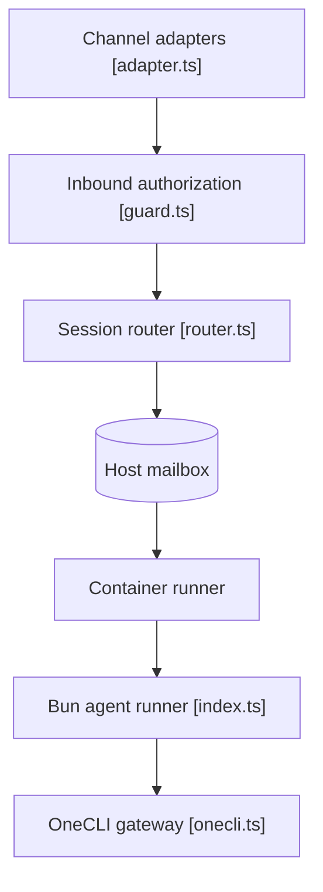

# nanocoai/nanoclaw

> Personal AI assistant that runs Claude agents in isolated Docker containers (same repository as qwibitai/nanoclaw).

## The problem
Giving an agent broad access to your digital life without understanding a huge codebase, nor real system isolation.

## What it actually does
The catalog and README are identical to qwibitai/nanoclaw. From the code: a Node host (`src/index.ts`) manages lifecycle, sweeping and durable reconciliation, authorizes inputs (`guard.ts`), then writes into the container's SQLite mailbox. The Bun container runs the Claude provider and the MCP tools. Agent-to-agent routes are filtered by a stored policy.

## How it is wired


## Trying it
```bash
git clone https://github.com/nanocoai/nanoclaw.git nanoclaw-v2
cd nanoclaw-v2
bash nanoclaw.sh
```

## Cost and gotchas
Anthropic credential via gateway, Docker, Node 22+ and pnpm 10+. Anonymous diagnostics can be disabled. Prebuilt image subject to a free account.

## What it is not
Not a framework configurable through files. Not a second project: same stars, dates and README as qwibitai/nanoclaw, probably an alias.

## Alternatives
- OpenClaw: cited in the README, bigger but more complete.

## For you
Worth watching: same verdict as its twin; evaluate it only once, since container isolation is the main appeal.
