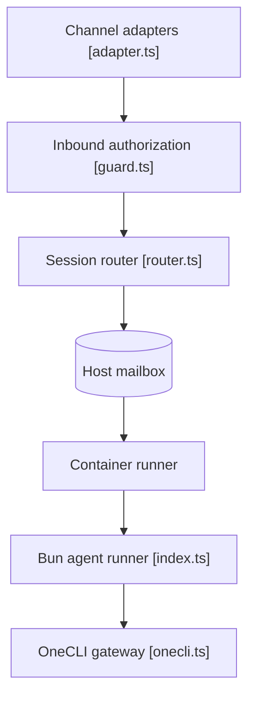

# nanocoai/nanoclaw

> Assistant IA personnel qui exécute des agents Claude dans des conteneurs Docker isolés (même dépôt que qwibitai/nanoclaw).

## Le problème
Donner à un agent un accès large à sa vie numérique sans comprendre un énorme code, ni vraie isolation système.

## Ce que ça fait vraiment
Le catalogue et le README sont identiques à qwibitai/nanoclaw. D'après le code : un hôte Node (`src/index.ts`) gère cycle de vie, balayage et réconciliation durable, autorise les entrées (`guard.ts`), puis écrit dans la boîte SQLite du conteneur. Le conteneur Bun exécute le fournisseur Claude et les outils MCP. Des routes agent-à-agent sont filtrées par une politique stockée.

## Comment c'est branché


## Essayer
```bash
git clone https://github.com/nanocoai/nanoclaw.git nanoclaw-v2
cd nanoclaw-v2
bash nanoclaw.sh
```

## Coût et pièges
Credential Anthropic via passerelle, Docker, Node 22+ et pnpm 10+. Diagnostics anonymes désactivables. Image préfabriquée soumise à un compte gratuit.

## Ce que ce n'est pas
Pas un framework configurable par fichiers. Pas un second projet : mêmes étoiles, dates et README que qwibitai/nanoclaw, alias probable.

## Alternatives
- OpenClaw : cité dans le README, plus gros mais plus complet.

## Pour toi
À surveiller : même verdict que son jumeau ; ne l'évaluer qu'une fois, l'isolation par conteneur étant l'intérêt principal.

