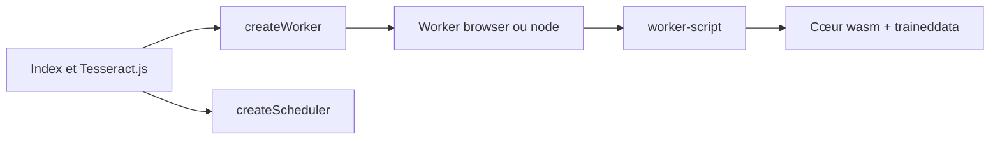

# naptha/tesseract.js

> Text recognition in images, in JavaScript, in the browser or under Node.js.

## The problem
Extract text from images without a dedicated OCR server or a call to a paid API, including on the browser side.

## What it actually does
The repository wraps the Tesseract engine compiled to WebAssembly (`tesseract.js-core`). A worker is created once, loads the wasm core and the language data, then processes each image; a scheduler distributes tasks across several workers. Outputs other than `text` are disabled by default since v6.

## How it is wired


## Trying it
```bash
npm install tesseract.js
yarn add tesseract.js
# Développement :
git clone https://github.com/naptha/tesseract.js.git
cd tesseract.js
npm install
npm start
```

## Cost and gotchas
Free. The first run downloads the core and languages (cached). Create the worker once then reuse it, not one per image. Node 16 or later for v7.

## What it is not
It is not an improved OCR: the README says it does not modify the recognition model and does not handle PDFs.

## Alternatives
- Scribe.js: for PDFs and model improvements, outside this repository's scope.

## For you
Adopt it if you need simple, local OCR on images; switch to Scribe.js as soon as PDFs are involved.
