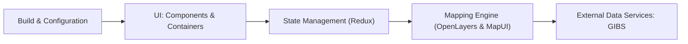

# nasa-gibs/worldview

> NASA web interface for browsing more than 1000 layers of global satellite imagery.

## The problem
Exploring and comparing satellite images from different dates and sensors means juggling between services and formats.

## What it actually does
Web client (React/Redux, OpenLayers) that displays imagery from NASA's GIBS service: layers updated daily, history going back about 30 years, Arctic/Antarctic views, geostationary imagery every 10 minutes over 90 days. Layer configuration is driven by JSON files processed at build time. The data can be downloaded.

## How it is wired


## Trying it
```bash
git clone https://github.com/nasa-gibs/worldview.git
cd worldview
npm ci
npm run build
npm start
```
Then http://localhost:3000.

## Cost and gotchas
Free; Node LTS required (Git Bash on Windows). Depends on the remote GIBS service. A license file is present but not recognized by GitHub.

## What it is not
Not an analysis tool: it is a viewer. The data stays at NASA.

## Alternatives
Leaflet, Cesium, Google Maps or GDAL scripts, cited as other possible GIBS clients.

## For you
Keep an eye on it: a source of images for geospatial or vision projects, but a viewer first; license to be confirmed.
