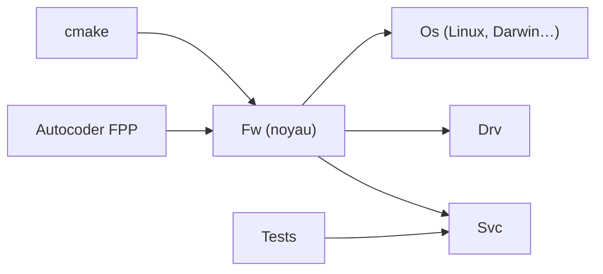

# nasa/fprime

> Component-based C++ framework for spaceflight software and embedded systems.

## The problem
Building custom flight software forces you to reinvent message queues, commands and telemetry.

## What it actually does
It splits the software into components with defined interfaces; a C++ framework provides queues, tasks and services; modeling tools (FPP) generate the code; ready-made components (Svc, Drv) and unit and integration testing tools complete it. Origin: JPL; deployed on several missions according to the README.

## How it is wired


## Trying it
```bash
pip install fprime-bootstrap
fprime-bootstrap project
```

## Cost and gotchas
Free. Requires Python 3.10+, git and a C/C++ compiler; Rust optional (1.87+).

## What it is not
Not a general-purpose tool: designed for CubeSats and instruments, unrelated to AI.

## Alternatives
No alternative named in the README.

## For you
Ignore for a data/AI profile, unless you have an embedded or space project: it is battle-tested but outside your scope.
