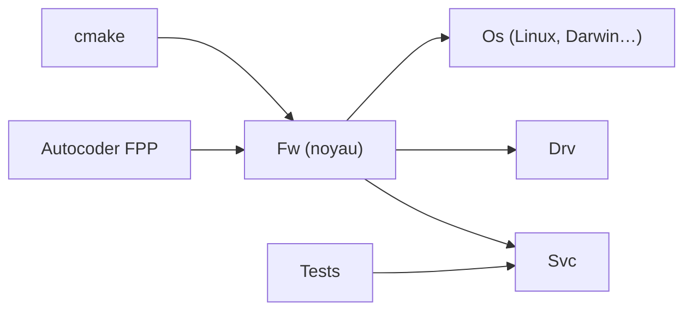

# nasa/fprime

> Framework C++ par composants pour logiciels de vol spatial et systèmes embarqués.

## Le problème
Concevoir un logiciel de vol sur mesure oblige à réinventer files de messages, commandes et télémétrie.

## Ce que ça fait vraiment
Découpe le logiciel en composants à interfaces définies ; un framework C++ fournit files, tâches et services ; des outils de modélisation (FPP) génèrent le code ; des composants prêts à l'emploi (Svc, Drv) et des outils de test unitaires et d'intégration complètent. Origine : JPL ; déployé sur plusieurs missions selon le README.

## Comment c'est branché


## Essayer
```bash
pip install fprime-bootstrap
fprime-bootstrap project
```

## Coût et pièges
Gratuit. Il faut Python 3.10+, git et un compilateur C/C++ ; Rust optionnel (1.87+).

## Ce que ce n'est pas
Pas un outil généraliste : pensé pour CubeSats et instruments, sans lien avec l'IA.

## Alternatives
Aucune alternative nommée dans le README.

## Pour toi
À ignorer pour un profil data/IA, sauf projet embarqué ou spatial : il est éprouvé mais hors de ton périmètre.

