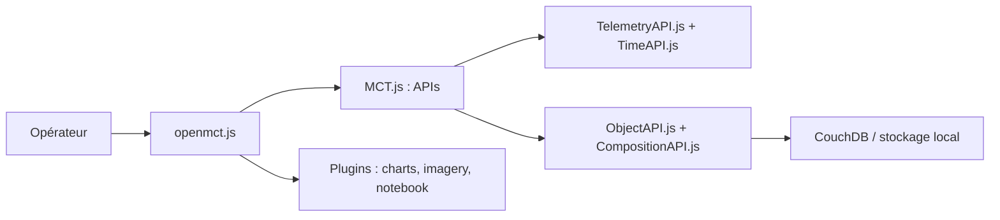

# nasa/openmct

> Extensible web framework for telemetry visualization, for mission control and planning.

## The problem
Mission operators need a single interface to browse mission objects and visualize time-based data.

## What it actually does
Plugin-based web application: object, composition, telemetry and time APIs; plugins for charts, imagery, notebook, plans, conditions and fault management. Local persistence or CouchDB. The README specifies that it is used as a dependency, behind an HTTP server.

## How it is wired


## Trying it
```bash
git clone https://github.com/nasa/openmct.git
nvm install
npm install
npm start
```
Then open http://localhost:8080/.

## Cost and gotchas
Free. With `ignore-scripts` enabled, a git dependency requires `npm run build`. Support for the legacy API (v2.0.0) is removed; 1,093 open issues.

## What it is not
Not a turnkey product: you must plug in your own telemetry source (e.g. the YAMCS plugin). License present but not identified by GitHub.

## Alternatives
- openmct-quickstart: example with Apache, YAMCS and CouchDB.
- openmct-tutorial: starting point for beginners.

## For you
Worth watching if you must display time series from an industrial or IoT system; outside that case, nothing for data/AI.
