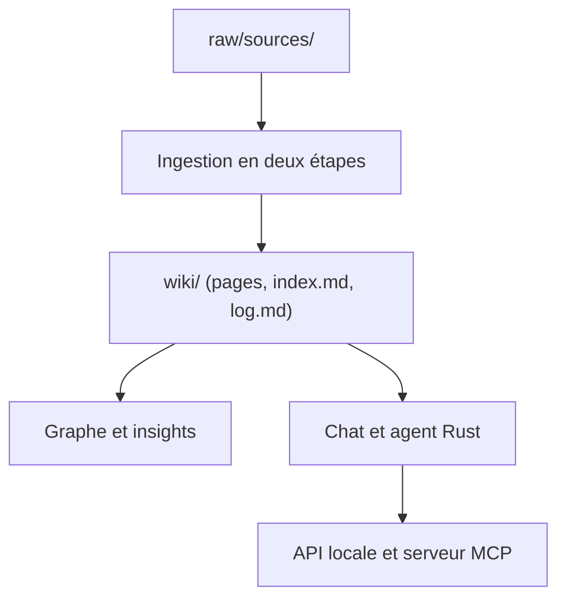

# nashsu/llm_wiki

> Desktop application that turns your documents into an interlinked wiki, kept up to date by an LLM.

## The problem
Classic RAG rediscovers knowledge on every query instead of compiling and maintaining it.

## What it actually does
Tauri v2 application (Rust, React). Two-step ingestion (analysis then wiki page generation) with SHA256 cache and persistent queue. Four-signal knowledge graph, community detection, optional vector search (LanceDB), web search (Tavily, SerpApi, SearXNG), agent with skills, local API 127.0.0.1:19828 and MCP server. README provided truncated at the end.

## How it is wired


## Trying it
```bash
git clone https://github.com/nashsu/llm_wiki.git
cd llm_wiki
npm install
npm --prefix mcp-server ci && npm run mcp:build
npm run tauri dev
```

## Cost and gotchas
LLM API key required, embeddings and web search extra. Build: Node 20+, Rust 1.88+, protoc. Each ingestion consumes tokens.

## What it is not
Not a simple RAG nor a hosted service. Young repository, a single person; the Chrome extension must be loaded by hand.

## Alternatives
Andrej Karpathy's LLM Wiki pattern, of which it is an implementation.

## For you
Watch: good basis for a personal knowledge base, but license not identified and token cost.
