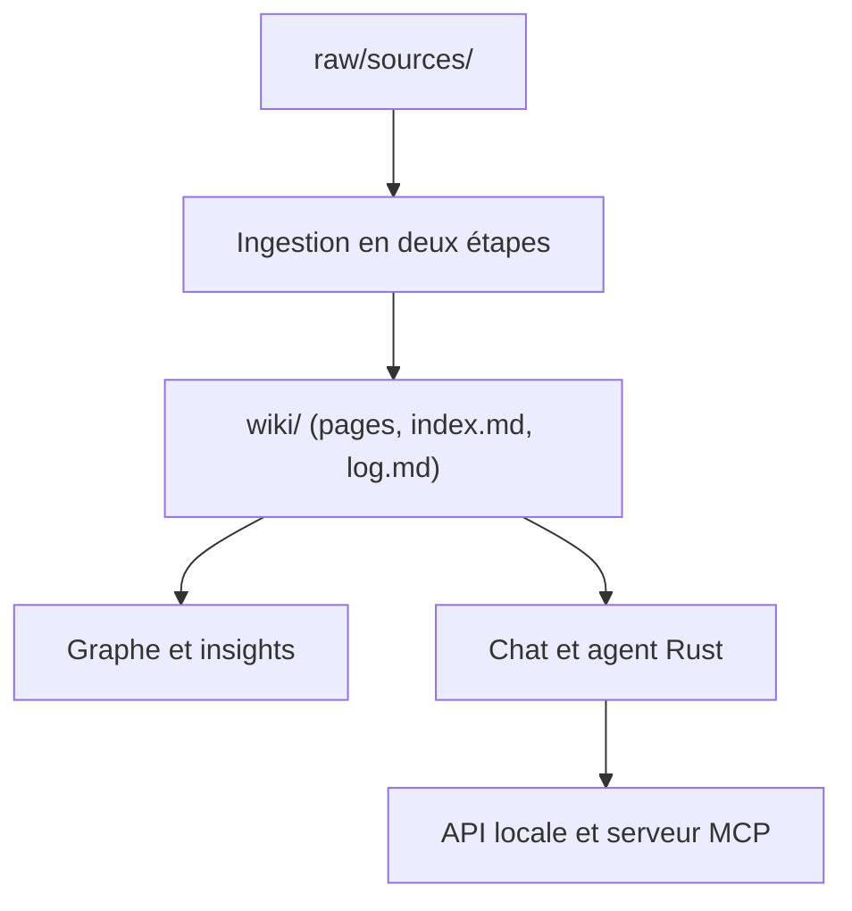

# nashsu/llm_wiki

> Application de bureau qui transforme tes documents en wiki interconnecté, tenu à jour par un LLM.

## Le problème
Le RAG classique redécouvre la connaissance à chaque requête au lieu de la compiler et la maintenir.

## Ce que ça fait vraiment
Application Tauri v2 (Rust, React). Ingestion en deux étapes (analyse puis génération de pages wiki) avec cache SHA256 et file persistante. Graphe de connaissances à quatre signaux, détection de communautés, recherche vectorielle optionnelle (LanceDB), recherche web (Tavily, SerpApi, SearXNG), agent avec skills, API locale 127.0.0.1:19828 et serveur MCP. README fourni tronqué en fin.

## Comment c'est branché


## Essayer
```bash
git clone https://github.com/nashsu/llm_wiki.git
cd llm_wiki
npm install
npm --prefix mcp-server ci && npm run mcp:build
npm run tauri dev
```

## Coût et pièges
Clé d'API LLM obligatoire, embeddings et recherche web en sus. Compilation : Node 20+, Rust 1.88+, protoc. Chaque ingestion consomme des jetons.

## Ce que ce n'est pas
Pas un simple RAG ni un service hébergé. Dépôt jeune, une seule personne ; l'extension Chrome est à charger à la main.

## Alternatives
Pattern LLM Wiki d'Andrej Karpathy, dont il est une implémentation.

## Pour toi
Surveiller : bonne base pour une base de connaissances personnelle, mais licence non identifiée et coût en jetons.

