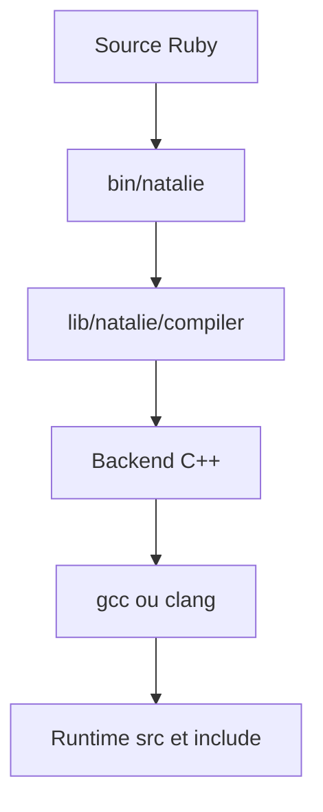

# natalie-lang/natalie

> Work-in-progress Ruby implementation that compiles ahead of time to C++, for language enthusiasts.

## The problem
Standard Ruby is interpreted; producing native executables requires a different compiler.

## What it actually does
Compiles Ruby to C++ with gcc or clang, offers a REPL with incremental compilation and can produce an executable. The author says much remains to be done before it is useful. Tested on macOS and Ubuntu, not on Windows. The specs come from ruby/spec.

## How it is wired


## Trying it
```sh
git clone https://github.com/natalie-lang/natalie
cd natalie
rake
bin/natalie examples/hello.rb
bin/natalie -c hello examples/hello.rb
```

## Cost and gotchas
Free. It requires Ruby MRI 3.2 or later with headers, autoconf, automake, libtool, make and gcc or clang: needs not listed in the standard prerequisites. A Docker image is also documented.

## What it is not
Not a ready-to-use replacement for Ruby: the author says it is unfinished.

## Alternatives
Ruby MRI, the reference implementation cited in the README.

## For you
Ignore: language prototype with no use in data or MLOps.
