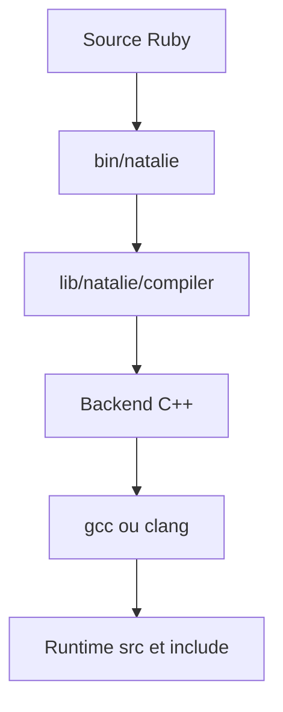

# natalie-lang/natalie

> Implémentation Ruby en chantier qui compile à l'avance vers C++, pour curieux de langages.

## Le problème
Ruby standard est interprété ; produire des exécutables natifs demande un autre compilateur.

## Ce que ça fait vraiment
Compile du Ruby en C++ avec gcc ou clang, offre un REPL à compilation incrémentale et peut produire un exécutable. L'auteur dit qu'il reste beaucoup à faire avant que ce soit utile. Testé sous macOS et Ubuntu, pas sous Windows. Les specs viennent de ruby/spec.

## Comment c'est branché


## Essayer
```sh
git clone https://github.com/natalie-lang/natalie
cd natalie
rake
bin/natalie examples/hello.rb
bin/natalie -c hello examples/hello.rb
```

## Coût et pièges
Gratuit. Il faut un Ruby MRI 3.2 ou plus avec en-têtes, autoconf, automake, libtool, make et gcc ou clang : besoins non listés dans les prérequis standards. Une image Docker est aussi documentée.

## Ce que ce n'est pas
Pas un remplaçant prêt à l'emploi de Ruby : l'auteur le dit inachevé.

## Alternatives
Ruby MRI, l'implémentation de référence citée dans le README.

## Pour toi
À ignorer : prototype de langage sans usage en data ou MLOps.

