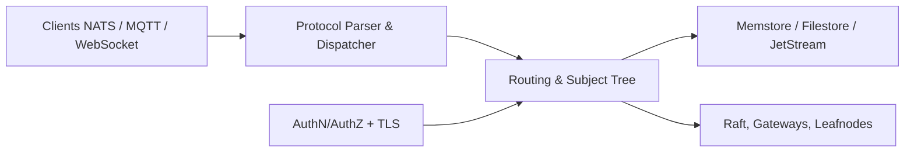

# nats-io/nats-server

> NATS messaging server, a CNCF project, for connecting services and devices through publish/subscribe.

## The problem
Distributed services need a simple, safe and fast message bus, from the server to the cloud to the edge device.

## What it actually does
Go server: publish/subscribe, request/reply and persistence (JetStream). Based on the architecture described: NATS, MQTT and WebSocket protocols; subject tree; memory or file storage; Raft clustering, gateways and leafnodes; authentication (NKEY, JWT, LDAP); hot configuration reload; HTTP monitoring API. More than 40 language clients exist, according to the README.

## How it is wired

## Trying it
No command documented in the README (it points to the website and the documentation).

## Cost and gotchas
Free, Apache-2.0. The README cites a security audit by Trail of Bits (April 2025). Cluster deployment requires reading the external documentation.

## What it is not
It is not a turnkey ML task queue nor an orchestrator: it is the message bus.

## Alternatives
No alternative cited in the README.

## For you
Watch: a credible candidate for connecting inference or collection services in MLOps, to be evaluated against your persistence and scale needs.
