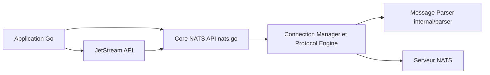

# nats-io/nats.go

> Official Go client for the NATS messaging system, with JetStream and a services API.

## The problem
Making services talk to each other through messages (publish, subscribe, request-reply) with persistence and reconnection.

## What it actually does
Connection, publish/subscribe, queue groups, subject wildcards, request-replies, authentication with credentials and Nkeys, TLS, cluster reconnection. The JetStream API adds persistent streams and consumers; a services API (`micro`) is in beta. Backward compatibility: fields added to structs and methods added to interfaces are not breaking changes.

## How it is wired


## Trying it
```bash
go get github.com/nats-io/nats.go@latest
```
```go
nc, _ := nats.Connect(nats.DefaultURL)
nc.Publish("foo", []byte("Hello World"))
```

## Cost and gotchas
A NATS server is required. Nkeys and credentials require a server of version 2.0 minimum. The library supports at least the last two minor versions of Go.

## What it is not
Not the NATS server itself (nats-server repository), nor a client for other languages. The `micro` API is in beta.

## Alternatives
No alternative named in the README (which points to "NATS by example").

## For you
Keep an eye on it: worth remembering if you build Go streaming or messaging services around your pipelines; otherwise a Python client is enough.
