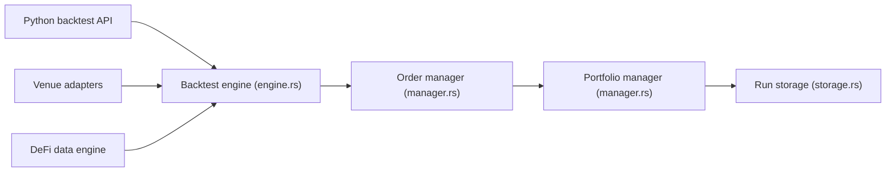

# nautechsystems/nautilus_trader

> Multi-asset trading engine in Rust, driven from Python, for backtests and live execution.

## The problem
Strategy research is often done in vectorized Python, then everything is rewritten in a compiled event-driven system for production.

## What it actually does
An event-driven Rust core runs the same strategy in deterministic backtest and in live, with Python as the control plane via PyO3. Adapters connect trading venues (Binance, Bybit, Interactive Brokers, Betfair, Polymarket, Databento...). Nanosecond-resolution multi-venue backtests, advanced order types, optional Redis persistence, Docker images and JupyterLab. The README warns that live differs from simulation.

## How it is wired


## Trying it
```bash
pip install -U nautilus_trader --pre
docker pull ghcr.io/nautechsystems/jupyterlab:nightly --platform linux/amd64
docker run -p 8888:8888 ghcr.io/nautechsystems/jupyterlab:nightly
```

## Cost and gotchas
Free. The v2 wheels are release candidates (2.0.0rcN): the README advises against live use with real capital. Without --pre, pip installs v1, which has different APIs. Linux: glibc 2.35 or later. LGPL-3.0 license. Rust is required only to build.

## What it is not
Not a turnkey bot nor a guarantee of profitability. Breaking changes may occur between versions.

## Alternatives
No alternative mentioned in the README.

## For you
Watch: interesting for rigorous event-driven backtesting with ML, but v2 is still a release candidate, LGPL and a niche domain.
