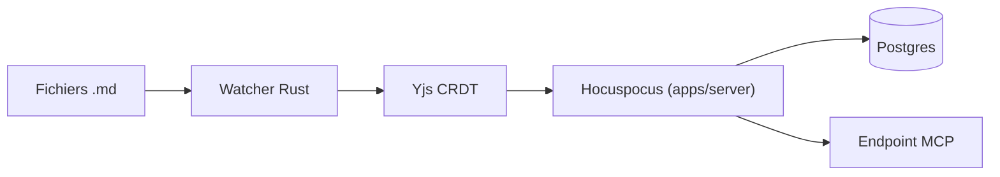

# naveedharri/baalda

> Note-taking app using local Markdown files, edited in real time by several people and by an AI.

## The problem
Note-taking tools choose between Markdown files editable by an AI and real-time collaboration.

## What it actually does
Tauri v2 desktop app where each note is a `.md` file on disk. A file watcher turns changes into CRDT operations (Yjs, Hocuspocus server on Postgres) for collaboration. A local agent such as Claude Code edits the files directly; remote agents go through an MCP endpoint with the same permissions as humans.

## How it is wired


## Trying it
```bash
cd app
pnpm install
cd apps/server
cp .env.example .env
pnpm run db:up
pnpm run migrate
pnpm run dev
pnpm run dev:desktop
```

## Cost and gotchas
Node 22+, Rust, Docker for Postgres. The Windows installer is not signed. A paid managed service exists at baalda.com; self-hosting is free.

## What it is not
Not yet proven: the repository dates from July 2026. The scaling figures (millions of notes) are README claims, not measured here.

## Alternatives
No alternative named in the README (it only mentions 41 Obsidian-like apps compared).

## For you
Worth watching: the combination of Markdown files, MCP and collaboration is useful for giving context to your agents, but the project is very young.
